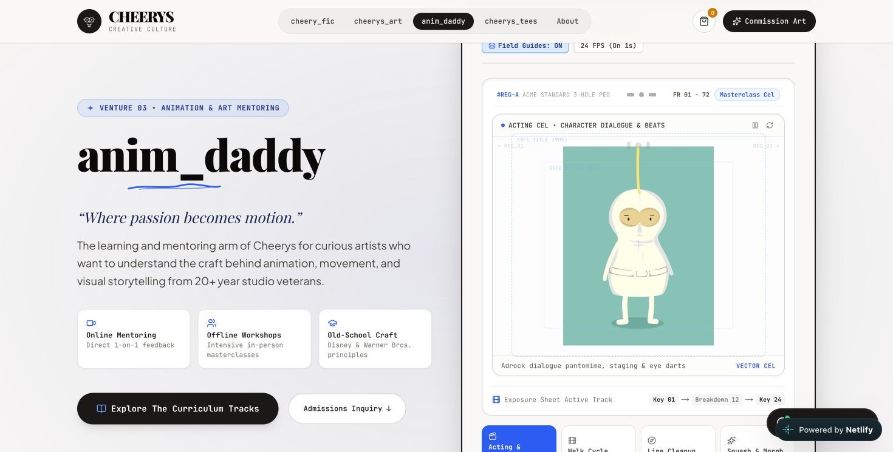
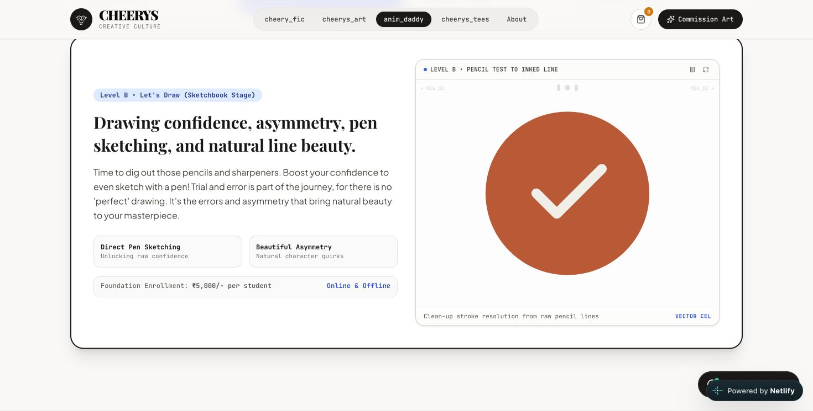
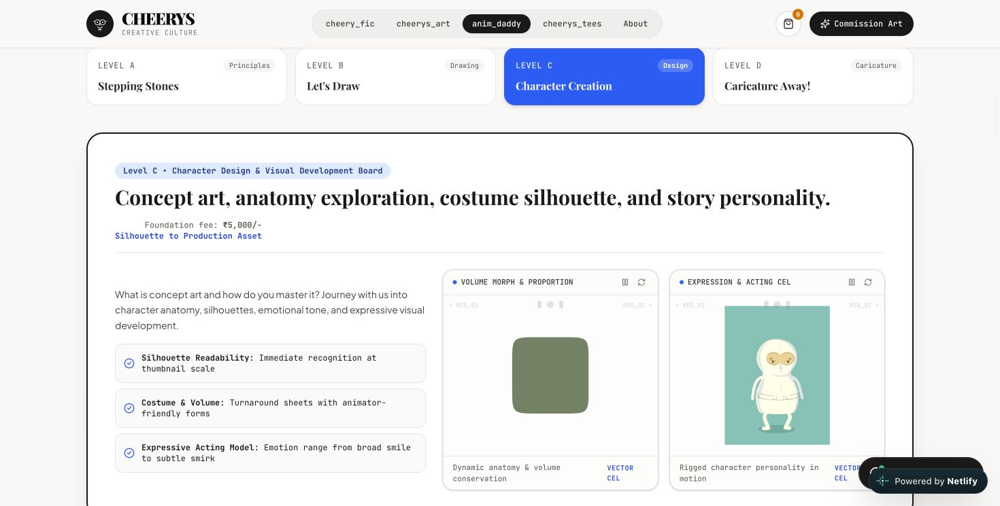
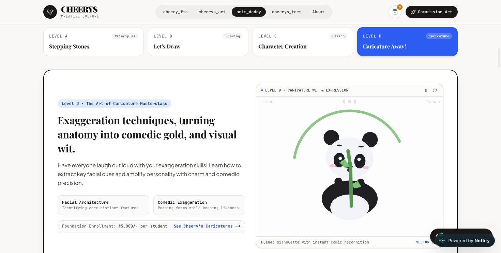

# AnimDaddy browser review — 11 November 2026

## Scope and baseline

- Live URL: https://cheerysworld.netlify.app/anim-daddy
- Repository source reviewed: `2df5828d1ee6e6185d1e2be71043a8a470314a26`
- Browser: user's selected Chrome tab, desktop viewport 1470 × 745 CSS pixels.
- This is a baseline review and preparation package. It does not claim the proposed redesign has been implemented or deployed.

## Actions performed

1. Inspected the hero, selected its alternate animation controls, toggled field guides, and toggled the FPS label before returning it to 24 FPS and the original Acting/Ninja selection.
2. Clicked foundation Levels A, B, C, D, then A again, and inspected their rendered panels.
3. Inspected the advanced curriculum and the three locally hosted module GIFs.
4. Paused and resumed Modules 1, 2, and 3. The controls changed between Play/Pause; resumed image sources were their correct local `.gif` paths. For Module 1, the paused source was the still preview through Next Image, and resuming returned to `/anim-daddy/module-01-wizard.gif`.
5. Checked browser warning/error logs captured during the session; none were returned at the time checked.
6. Clicked the Admissions Inquiry CTA and confirmed the enquiry heading was visible at `/anim-daddy#enquiry`; returned the tab to the hero after inspection.

No production enquiry was submitted. Mobile layout, throttled-network timing, and quantitative performance measurements are acceptance work for the implementing agent; they were not measured in this review.

## Observed problems

| Area | Browser observation | Supporting source finding | Required direction |
| --- | --- | --- | --- |
| Hero | Ninja is enclosed in a large Lightbox/24 FPS desk with field guides, registration labels, exposure-sheet details, and four competing media choices. | `AnimDaddyHeroReel.tsx` builds this UI; the FPS state changes its text but is not connected to animation speed. | Keep Ninja; replace the surrounding UI with one simple media area. |
| Level A | A cat walk appears beside copy about animating everyday inanimate objects. | Asset is `lottie-cat-walk.json`. | Use the prepared bouncing-ball example. |
| Level B | A white checkmark in an orange circle is presented as a pencil/line-cleanup demonstration. | `lottie-draw-on.json` is named Logo Draw On. | Use the prepared pencil-drawing loop. |
| Level C | Two simultaneous framed visuals appear: a shape morph and the same Ninja already used in the hero. | Two Lottie players are rendered in the Level C branch. | One character-expression visual in the same layout as other levels. |
| Level D | A panda and loading-ring graphic accompany caricature copy. | `lottie-character.json` is Panda Bamboo Loader Loop. There is one player here, not two. | Use the prepared facial-expression study and retain the authentic caricature link. |
| Switching | Immediately after a return to Level A, its text was present but the curriculum had no animation SVG; after scrolling the stage into view, an 800 × 800 animation SVG and controls were present. | The player waits for intersection and destroys/reloads on visibility changes; level conditionals also remount it. | Poster-first display, advance loading, cached media, stable layout, and separated load/play lifecycle. |
| Advanced section | Each of five groups repeats a large animation panel in addition to the three specific module GIFs. | Five track-level `LottieAnimationPlayer` instances plus module media. | Compact module presentation; retain the client-selected GIFs only in their correct modules. |

The SVG observation records readiness, not an elapsed-time benchmark. The code identifies a concrete cause of repeat initialization; it does not prove every perceived delay is due solely to networking.

## Screenshots

### Hero: excessive production-desk framing

### Level B: checkmark used as drawing demonstration

### Level C: duplicate visual stages

### Level D: panda loading graphic

## Prepared handoff

The [implementation brief](../anim-daddy-simplification.md) specifies the new hierarchy, exact asset mapping, loading behavior, source files, and verification gates. New GIF originals, optimized animated WebPs, and representative posters are in `public/anim-daddy/foundation/`. The existing Ninja animation remains available, and a clean poster has been prepared at `public/anim-daddy/hero-ninja-poster.webp`.
